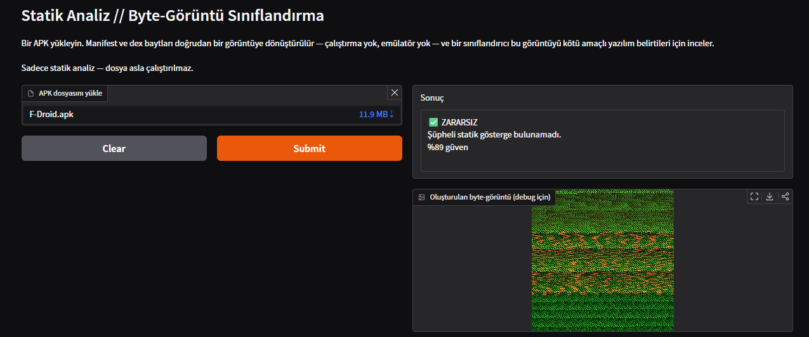

# APK Static Scanner

A web tool that performs static analysis on Android APK files and flags
whether they look benign or potentially malicious — without ever
installing or executing the file.

Developed during an internship connected to the author of the thesis
this project's core technique is based on (see Credit below).

**Live demo:** https://huggingface.co/spaces/Tirsit/APK_Statik_Scanner



---

## English

### Overview

Instead of manually parsing an APK's code or permissions, this tool reads
two files straight out of the APK archive — `AndroidManifest.xml` and
`classes.dex` — as raw bytes, and converts those bytes directly into an
image. A small CNN then looks at that image for patterns in the raw byte
layout that would be tedious to hand-engineer as features.

**Pipeline:**

1. The user uploads an `.apk` file.
2. The app unzips it and reads the raw bytes of `AndroidManifest.xml` and
   `classes.dex`. Nothing is parsed, decompiled or executed.
3. Each byte array is fitted into a fixed 255×255 grid (zero-padded if
   shorter, cut to the first 65,025 bytes if longer) and resized to
   224×224. Manifest → red channel, dex → green channel, blue channel = 0.
4. A MobileNetV2 classifier inspects the image and returns a verdict —
   **benign** or **malicious** — with a confidence score.

### The model

- MobileNetV2 (`timm`, `mobilenetv2_100`), pretrained backbone fine-tuned
  for 2 classes.

### Limitations (please read)

- Only the first ~64 KB of `classes.dex` is used; the rest is ignored. Apps
  with several dex files (`classes2.dex`, …) only have the first one read.
- No dynamic-analysis channel and no CBAM/Xception architecture from the
  thesis (see Credit).
- This is an educational/demo project, not a production-grade security
  tool. Don't rely on it for real security decisions.

### Credit

The byte-to-image concept this project applies is based on the static
analysis approach described in:

> Kılıç, K. (2025). _Çok kanallı görüntü temsillerinden dikkat katmanlı
> hibrit derin öğrenme mimarisi ile Android kötücül yazılım tespiti_
> [Doctoral dissertation]. Gazi University, Graduate School of Natural and
> Applied Sciences.

This project implements only the **static analysis** portion of that work
(manifest + dex byte-image construction), scoped down for an internship
project. It does not include the thesis's dynamic-analysis channel, its
CBAM-attention/Xception hybrid architecture, or its full training pipeline.

### Tech stack

- Python, PyTorch, `timm`, Gradio, Pillow, NumPy
- Hosted as a Hugging Face Space

### Project structure

```
apk-static-scanner/
├── app.py              # Gradio app (entry point, also used by the Space)
├── requirements.txt
├── backend/
│   ├── apk_utils.py    # APK extraction + byte-to-image conversion
│   ├── model.py        # loads model.pth and classifies an image
│   └── model.pth       # trained MobileNetV2 weights (~9 MB)
└── screenshots/
    └── demo.png
```

### Running it locally

```bash
python -m venv venv
venv\Scripts\activate        # Windows
# source venv/bin/activate   # Mac/Linux
pip install -r requirements.txt
python app.py
```

Open the address printed in the terminal (usually
**http://127.0.0.1:7860**). The first install takes a while because PyTorch
is a large download. The `spaces` package and the `@spaces.GPU` line in
`app.py` are only needed on Hugging Face; they do nothing when run locally,
and the model runs on CPU.

---

## Türkçe

### Genel Bakış

Bu araç, bir APK'nin kodunu veya izinlerini elle ayrıştırmak yerine, APK
arşivinin içinden iki dosyayı — `AndroidManifest.xml` ve `classes.dex` —
doğrudan ham bayt (byte) verisi olarak okur ve bu baytları bir görüntüye
dönüştürür. Küçük bir CNN, elle özellik çıkarımı yapmanın zahmetli olacağı
ham bayt düzenindeki örüntüleri bu görüntü üzerinde arar.

**İşlem hattı (pipeline):**

1. Kullanıcı bir `.apk` dosyası yükler.
2. Uygulama APK'yi açar ve `AndroidManifest.xml` ile `classes.dex`
   dosyalarının ham baytlarını okur. Hiçbir şey ayrıştırılmaz, tersine
   mühendislik yapılmaz veya çalıştırılmaz.
3. Her bayt dizisi sabit 255×255'lik bir ızgaraya yerleştirilir (kısaysa
   sıfırlarla doldurulur, uzunsa ilk 65.025 bayt alınır) ve 224×224'e
   küçültülür. Manifest → kırmızı kanal, dex → yeşil kanal, mavi kanal = 0.
4. MobileNetV2 sınıflandırıcısı görüntüyü inceler ve bir güven skoruyla
   birlikte **zararsız (benign)** ya da **zararlı (malicious)** sonucunu
   döndürür.

### Model

- MobileNetV2 (`timm`, `mobilenetv2_100`); önceden eğitilmiş omurga 2 sınıf
  için ince ayarlandı.

### Sınırlamalar (lütfen okuyun)

- `classes.dex` dosyasının yalnızca ilk ~64 KB'ı kullanılır; geri kalanı
  yok sayılır. Birden fazla dex dosyası olan uygulamalarda (`classes2.dex`
  vb.) yalnızca ilk dosya okunur.
- Tezdeki dinamik analiz kanalı ve CBAM/Xception mimarisi yoktur (bkz.
  Kaynak).
- Bu proje eğitim/demo amaçlı bir çalışmadır, üretim seviyesinde bir
  güvenlik ürünü değildir. Gerçek güvenlik kararları için buna güvenmeyin.

### Kaynak / Atıf

Bu projede uygulanan bayt-görüntü (byte-to-image) yaklaşımı, aşağıdaki
çalışmada tanımlanan statik analiz yöntemine dayanmaktadır:

> Kılıç, K. (2025). _Çok kanallı görüntü temsillerinden dikkat katmanlı
> hibrit derin öğrenme mimarisi ile Android kötücül yazılım tespiti_
> [Doktora tezi]. Gazi Üniversitesi, Fen Bilimleri Enstitüsü.

Bu proje, söz konusu çalışmanın yalnızca **statik analiz** kısmını
(manifest + dex bayt-görüntü oluşturma) bir staj projesi kapsamında
sadeleştirilmiş haliyle uygular. Tezdeki dinamik analiz kanalı, CBAM
dikkat katmanlı Xception hibrit mimarisi ve tam eğitim süreci bu kapsama
dahil değildir.

### Teknoloji Yığını

- Python, PyTorch, `timm`, Gradio, Pillow, NumPy
- Hugging Face Space olarak barındırılır

### Proje Yapısı

```
apk-static-scanner/
├── app.py              # Gradio uygulaması (giriş noktası, Space de bunu kullanır)
├── requirements.txt
├── backend/
│   ├── apk_utils.py    # APK çıkarma + bayt-görüntü dönüşümü
│   ├── model.py        # model.pth'yi yükler ve görüntüyü sınıflandırır
│   └── model.pth       # eğitilmiş MobileNetV2 ağırlıkları (~9 MB)
└── screenshots/
    └── demo.png
```

### Yerel Olarak Çalıştırma

```bash
python -m venv venv
venv\Scripts\activate        # Windows
# source venv/bin/activate   # Mac/Linux
pip install -r requirements.txt
python app.py
```

Terminalde yazan adresi aç (genellikle **http://127.0.0.1:7860**). İlk
kurulum biraz sürer, çünkü PyTorch büyük bir indirmedir. `spaces` paketi ve
`app.py` içindeki `@spaces.GPU` satırı yalnızca Hugging Face'te gerekir;
yerelde çalıştırınca hiçbir şey yapmaz ve model CPU üzerinde çalışır.